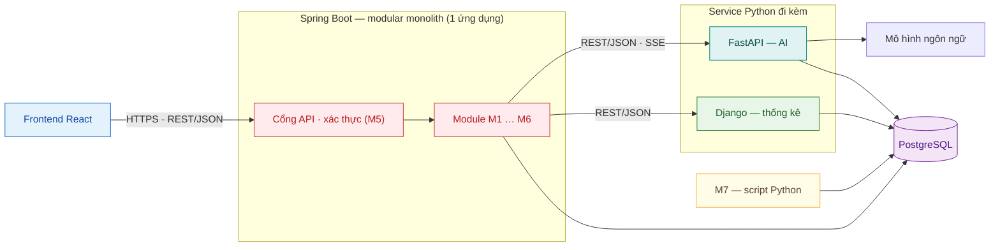

# Công nghệ và kiến trúc backend (khuyến nghị)

Tài liệu này ghi **khuyến nghị** của nhóm về ngôn ngữ, framework và kiến trúc để mọi thành viên biết module của mình nên viết bằng gì. Bản tóm tắt trên Jira: **SCRUM-13**. Nhật ký thay đổi tài liệu: **SCRUM-125**.

> **Khuyến nghị, không bắt buộc.** Nhóm ưu tiên các lựa chọn dưới đây; nếu module của bạn cần lựa chọn khác, trao đổi với Scrum Master và ghi vào SCRUM-125.
>
> **Đây là kiến trúc sơ bộ.** Nhóm đã có hướng đi nhưng **chưa triển khai và chưa kiểm thử hoàn tất toàn bộ module**, vì nhiều module khó (Safety Gate, trợ lý AI có RAG, thống kê, nhắc nhở theo lịch). Chi tiết từng module có thể còn thay đổi khi làm; mọi thay đổi ghi vào SCRUM-125 và cập nhật lại file này.

## Tóm tắt

| Phần                  | Công nghệ khuyến nghị                    | Vai trò                                                                               |
| --------------------- | ---------------------------------------- | ------------------------------------------------------------------------------------- |
| Frontend              | React, TypeScript, Vite                  | Giao diện tiếng Việt, chỉ gọi API của Spring Boot                                     |
| Backend chính         | **Java, Spring Boot — modular monolith** | Phần lớn nghiệp vụ M1–M6, cổng API duy nhất, xác thực và phân quyền                   |
| Dịch vụ AI            | **Python, FastAPI**                      | Safety Gate, RAG, gọi mô hình ngôn ngữ, kiểm tra đầu ra, trả lời dạng streaming (SSE) |
| Dịch vụ thống kê      | **Python, Django**                       | Xu hướng chỉ số sức khỏe (UC-05), thống kê hệ thống (UC-19)                           |
| Cơ sở dữ liệu         | PostgreSQL                               | Mỗi module một schema                                                                 |
| Dữ liệu tri thức (M7) | Python (script chạy ngoài ứng dụng)      | Crawl, chuẩn hóa, chia chunk, nạp vào kho tri thức                                    |

**Nguyên tắc ưu tiên:** phần lớn module nên viết bằng **Java (Spring Boot)**. Những module hoặc chức năng đặc thù về **AI hay thống kê** nên viết bằng **Python**. Một module có thể có cả hai phần: phần quản lý dữ liệu ở Spring Boot, phần AI hoặc thống kê ở service Python.

## Kiến trúc modular monolith (khuyến nghị)

- **Một ứng dụng Spring Boot, triển khai một lần.** M1–M6 là các module bên trong, không tách thành microservice.
- **Mỗi module có ranh giới riêng:** package riêng (controller, service, repository) và schema CSDL riêng. Module khác chỉ gọi qua interface công khai của module đó, **không truy cập thẳng bảng của module khác**.
- **Service Python chỉ là service đi kèm** cho phần AI và thống kê. Chúng không chứa nghiệp vụ chính và chỉ nhận lời gọi từ Spring Boot.

## Ngôn ngữ theo module (khuyến nghị)

| Module                     | Người phụ trách          | Ưu tiên Java – Spring Boot                                                       | Khuyến nghị Python                                             |
| -------------------------- | ------------------------ | -------------------------------------------------------------------------------- | -------------------------------------------------------------- |
| M1 Safety Gate             | Tăng Nguyễn Bảo Quỳnh    | Soạn, lưu nháp, gửi duyệt quy tắc (UC-16); phê duyệt quy tắc (phần UC-17)        | FastAPI: bộ đánh giá Safety Gate (UC-07)                       |
| M2 Tra cứu và nội dung     | Nguyễn Xuân Trường Giang | Toàn bộ (UC-10, 11, 15); phê duyệt bài viết, mẫu, xử lý phản hồi AI (phần UC-17) | —                                                              |
| M3 Hồ sơ, chỉ số, thống kê | Vũ Quang Dũng            | Hồ sơ, ghi chỉ số theo ngày (UC-04, UC-05)                                       | Django: xu hướng chỉ số, thống kê hệ thống (UC-19)             |
| M4 Hội thoại với trợ lý AI | Đặng Việt Thành          | Lịch sử hội thoại, đánh giá câu trả lời (UC-08, UC-09)                           | FastAPI: điều phối chat, RAG, gọi LLM, kiểm tra đầu ra (UC-06) |
| M5 Tài khoản, phân quyền   | Võ Ngọc Tài              | Toàn bộ (UC-01, 02, 03, 18), xác thực dùng chung                                 | —                                                              |
| M6 Lộ trình, nhắc nhở      | Lữ Kim Luân              | Toàn bộ (UC-12, 13, 14), bộ lập lịch gửi nhắc                                    | —                                                              |
| M7 Tiền xử lý dữ liệu      | Lữ Kim Luân              | —                                                                                | Script Python ngoài ứng dụng (không gắn FR/UC)                 |

**UC-17 dùng chung cho M1 và M2 ở hai mức:** M1 phê duyệt quy tắc cảnh báo (Safety Gate chỉ dùng quy tắc đã duyệt); M2 phê duyệt bài viết, mẫu kế hoạch và xử lý phản hồi câu trả lời AI. Hai bên dùng chung hàng đợi duyệt và trạng thái duyệt, thống nhất hợp đồng trước khi code.

## Gợi ý giao tiếp giữa Spring Boot và service Python

1. **Frontend chỉ gọi Spring Boot.** Spring Boot xác thực phiên, kiểm tra quyền và sự đồng ý xử lý dữ liệu sức khỏe rồi mới gọi Python.
2. **Spring Boot gọi FastAPI và Django bằng REST/JSON** (RestClient/WebClient) trong mạng nội bộ, kèm khóa dịch vụ lấy từ biến môi trường. Service Python không mở ra Internet.
3. **Streaming câu trả lời chat:** FastAPI trả SSE, Spring Boot chuyển tiếp xuống trình duyệt.
4. **Chỉ gửi dữ liệu tối thiểu sang dịch vụ AI:** không gửi họ tên, email. Log không ghi nội dung hội thoại hay hồ sơ sức khỏe.
5. **Khi service Python lỗi,** Spring Boot vẫn chạy các chức năng không phụ thuộc và trả thông báo phù hợp.

Trước khi code phần gọi nhau giữa hai module hoặc hai service, hai người phụ trách thống nhất **hợp đồng API dạng JSON** (mô tả bằng OpenAPI) và ghi vào issue liên quan.

## Tình trạng mã nguồn hiện tại

- Khung đang có trong `apps/api`, `apps/web`, `packages/contracts` (Express + TypeScript, dựng ngày 29/10) **chưa phản ánh khuyến nghị này**.
- Việc dựng khung Spring Boot, FastAPI, Django sẽ được giao qua issue riêng. Trước khi viết mã backend mới, xem issue đó hoặc hỏi Scrum Master.
- Quy trình làm việc không đổi: issue → nhánh `<số-issue>-<mô-tả>` → PR, xem [CONTRIBUTING.md](../CONTRIBUTING.md).
