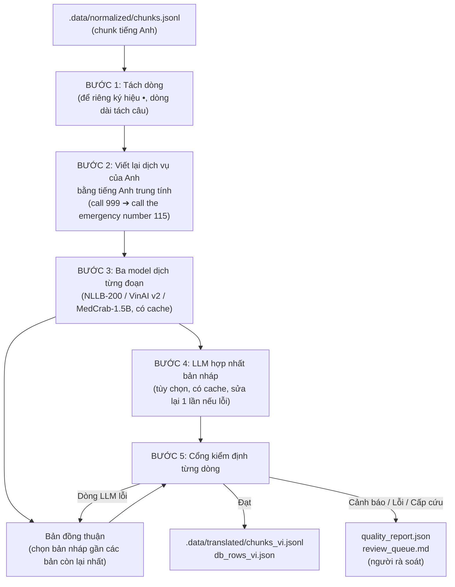

# THIẾT KẾ KIẾN TRÚC MODULE DỊCH TỰ ĐỘNG Y KHOA SONG NGỮ ANH - VIỆT
## (Medical Translation Engine Architectural Specification & Roadmap)

**Dự án:** SE214 - Health Recommendation ChatBox (Nhóm 5)  
**Tài liệu:** `docs/TRANSLATION_MODULE_DESIGN.md`  
**Trạng thái:** Đã hiện thực tại `tools/translate/` (issue #108), chạy được toàn bộ pipeline, có bộ kiểm thử; đã chạy thử hai lô (mục 8)  

---

## 1. Bối cảnh & Mục tiêu dự án

### 1.1. Bối cảnh dữ liệu
Kho tri thức sau bước chuẩn hóa (`.data/normalized/`, số liệu tại lần chuẩn hóa `as_of` 10/11/2026) gồm 136 bài viết, 414 RAG chunk:
- **394 chunk tiếng Anh từ NHS Anh Quốc** (khoảng 94.600 từ, trung bình 240 từ/chunk, tối đa 397): dấu hiệu nhận biết, tự chăm sóc tại nhà, cảnh báo đỏ, dinh dưỡng, vận động, giấc ngủ.
- **20 chunk tiếng Việt từ WHO Việt Nam**: giữ nguyên, không dịch.

Mỗi chunk là một khối **nhiều dòng ngắn** (tiêu đề mục, câu, gạch đầu dòng `•`): 394 chunk có khoảng 7.000 dòng, chỉ 12 dòng dài hơn 60 từ. Đặc điểm này quyết định cách dịch ở mục 3.

### 1.2. Mục tiêu của Module Dịch (`tools/translate/`)
Công cụ dịch ngoại tuyến theo lô (Offline Batch Translation), chuyển các chunk tiếng Anh của NHS sang tiếng Việt với các tiêu chí:
1. **Không gây ảo giác (Zero Hallucination):** không thêm bớt triệu chứng, không bịa liều lượng, không làm nhẹ cảnh báo cấp cứu. Mọi con số của dòng gốc phải có trong dòng dịch.
2. **Bảo toàn tên hoạt chất quốc tế (Active Ingredient Preservation).**
3. **Bản địa hóa an toàn (Safety Localization):** dịch vụ đặc thù của Anh (999, 111, GP, A&E) đổi sang bối cảnh Việt Nam (115, bác sĩ, cơ sở y tế, khoa cấp cứu).
4. **Kiến trúc tách bạch (Decoupled):** chạy độc lập qua CLI, không import mã backend/frontend.
5. **Chạy lại được (Resumable):** mọi bản dịch được cache theo từng đoạn; dừng giữa chừng thì chạy tiếp, không dịch lại.

---

## 2. Lựa chọn Mô hình (Model Selection)

Hệ thống **không tin một mô hình nào một mình**. Ba mô hình dịch chuyên dụng chạy cục bộ cho ba bản nháp độc lập; một LLM đóng vai biên tập viên hợp nhất các bản nháp; cổng kiểm định tự động quyết định dòng nào được giữ.

```
        ┌───────────────┐   ┌───────────────┐   ┌───────────────┐
        │   NLLB-200    │   │ VinAI Translate│   │  MedCrab-1.5B │
        │   (Meta AI)   │   │      v2       │   │   (UMP/Qwen)  │
        ├───────────────┤   ├───────────────┤   ├───────────────┤
        │ NMT đa ngữ    │   │ NMT Anh-Việt  │   │ LLM dịch y khoa│
        │ Seq2Seq       │   │ Seq2Seq mBART │   │ 300K cặp câu  │
        └───────┬───────┘   └───────┬───────┘   └───────┬───────┘
                └────────── 3 bản nháp / dòng ──────────┘
                                    ▼
                  ┌──────────────────────────────────┐
                  │ LLM biên tập (hợp nhất bản nháp) │  tùy chọn
                  └────────────────┬─────────────────┘
                                   ▼
                  ┌──────────────────────────────────┐
                  │ Cổng kiểm định từng dòng          │
                  │ lỗi → bản đồng thuận của 3 model │
                  └──────────────────────────────────┘
```

### 2.1. Model 1: NLLB-200 (Meta AI) — NMT đa ngữ
- **Hugging Face ID:** `facebook/nllb-200-distilled-600M`
- **Kiến trúc:** Sequence-to-Sequence NMT. Mã ngôn ngữ `eng_Latn` → `vie_Latn`.
- **Vai trò:** bản nháp bám sát câu chữ nhất, khó "sáng tác"; nhẹ, chạy được cả trên CPU.

### 2.2. Model 2: VinAI Translate v2 — NMT chuyên cặp Anh - Việt
- **Hugging Face ID:** `vinai/vinai-translate-en2vi-v2`
- **Kiến trúc:** Seq2Seq (mBART), mã ngôn ngữ `en_XX` → `vi_VN` (bộ giải mã bắt đầu bằng mã ngôn ngữ đích).
- **Vai trò:** tiếng Việt tự nhiên nhất trong ba bản nháp.
- **Lưu ý:** checkpoint `vinai-translate-en2vi-v2` là bản dịch tổng quát, không phải bản đã tinh chỉnh trên bộ MedEV (khoảng 360.000 cặp câu y khoa, LREC-COLING), nên engine mang tên `vinai` (tên `medev` vẫn dùng được như bí danh).

### 2.3. Model 3: MedCrab-1.5B — LLM dịch y khoa
- **Hugging Face ID:** `pnnbao-ump/MedCrab-1.5B`
- **Kiến trúc:** Causal LM tinh chỉnh từ `Qwen/Qwen2.5-1.5B` trên bộ `MedCrab` (300.000 cặp dịch y sinh do bác sĩ thẩm định). Tác giả công bố BLEU 42–46, COMET 0,68–0,72 trên đoạn 100–150 từ.
- **Vai trò:** thuật ngữ lâm sàng chính xác nhất.
- **Lưu ý:** dùng đúng khuôn prompt của tác giả (`<|ENGLISH_TEXT_START|>…<|ENGLISH_TEXT_END|>`, dừng ở `<|VIETNAMESE_TEXT_END|>`), không dùng khuôn hội thoại của Qwen.

### 2.4. LLM biên tập (tùy chọn)
- Một endpoint tương thích OpenAI do người chạy tự cấu hình bằng `LLM_BASE_URL`, `LLM_MODEL`, `LLM_API_KEY` (cùng quy ước với các script rà soát của `tools/normalize`). Repo không ghi sẵn endpoint, model hay key; người chạy đặt qua biến môi trường.
- Mục này tả chế độ `fusion` (lần chạy 1–3). Từ lần chạy 4, mặc định là chế độ `direct`: LLM dịch trọn từng chunk từ bản tiếng Anh, không dùng ba model ở trên. Cổng luật, lượt LLM đọc lại nghĩa và câu người duyệt đã sửa vẫn giữ nguyên; dòng lỗi không còn bản đồng thuận để thay nên chunk chuyển sang người duyệt. Chi tiết ở `tools/translate/README.md`.
- **Vì sao vẫn dùng LLM đa dụng dù rủi ro "sáng tạo":** ba model chuyên dụng dịch từng dòng rời nên không biết ngữ cảnh ("Do" / "Don't" là tiêu đề danh sách), không biết bản địa hóa, và mỗi model có kiểu lỗi riêng. LLM sửa được các lỗi này, còn rủi ro của nó bị chặn bằng ba ràng buộc:
  1. LLM **không dịch một mình**: nhận dòng gốc kèm các bản nháp và chỉ được trả đúng một dòng cho mỗi dòng.
  2. Mọi dòng LLM trả về phải qua cổng kiểm định (số liệu, dịch vụ, cấu trúc). Dòng lỗi được gửi lại một lần kèm danh sách lỗi; vẫn lỗi thì **thay bằng bản đồng thuận** của ba model.
  3. Dòng cuối không giống bản nháp nào (`low_support`) bị gắn cờ cho người rà soát — dấu hiệu LLM thêm nội dung.
- Không cấu hình LLM thì pipeline vẫn chạy đủ với bản đồng thuận (`--refiner consensus`).

### 2.5. Giấy phép
NLLB-200 và MedCrab-1.5B: CC BY-NC 4.0. VinAI Translate v2: AGPL-3.0. Phù hợp đồ án học thuật, phi thương mại.

---

## 3. Quy trình Xử lý & Các Cổng An toàn (Pipeline Workflow)



### 3.1. Dịch theo dòng
Model dịch câu (NLLB, VinAI) cắt cụt hoặc bỏ ý khi nhận cả chunk 240 từ nhiều dòng. Vì vậy đơn vị dịch là **dòng**:
- Ký hiệu đầu dòng (`•`, `-`, `1.`) được tách riêng và gắn lại nguyên vẹn; model chỉ thấy phần chữ.
- Chỉ dòng dài hơn 60 từ mới tách tiếp thành câu.
- Đoạn trùng nhau giữa các chunk (ví dụ "Non-urgent advice: See a GP if:") chỉ dịch một lần.
- Bản tiếng Việt luôn có **đúng số dòng và số gạch đầu dòng** của bản gốc — nền tảng để kiểm từng dòng ở mục 3.6.
- Tiêu đề bài, tiêu đề mục và các dòng của bài viết không nằm trong chunk nào được gom thành nhóm riêng và đi qua cùng pipeline.

### 3.2. Quy tắc Bản địa hóa & Chuẩn hóa Thuật ngữ (Terminology & Localization Guidelines)

Toàn bộ quy tắc nằm trong `tools/translate/localisation.json`, không nằm trong mã. Có ba lớp:

1. **Viết lại nguồn bằng tiếng Anh trung tính** trước khi đưa cho ba model (`source_rewrites`): `call 999` → `call the emergency number 115`, `A&E` → `the hospital emergency department`, `a GP` → `a doctor`, `call 111 or get help from 111 online` → `contact a doctor or the nearest health facility for advice`. Model vẫn nhận tiếng Anh sạch nên không bị nhiễu (cách cũ chèn cụm tiếng Việt vào giữa câu tiếng Anh làm model dịch sai cả câu).
2. **Bảng hướng dẫn cho LLM biên tập** (các bảng A, B, C dưới đây).
3. **Kiểm trên bản tiếng Việt:** `999`, `111`, `GP`, `A&E` không được còn lại (chặn); `NHS`, "nhũ nhi", số điện thoại của Anh thì gắn cờ rà soát.
4. **Viết số theo kiểu Việt** (`number_format` trong `localisation.json`): dấu phẩy thập phân, dấu cách nhóm hàng nghìn, ví dụ `1.5mg (1,500 µg)` → `1,5mg (1 500 µg)`. Model hay chép nguyên số kiểu Anh, và người đọc Việt sẽ hiểu `1,500 µg` là 1,5 µg (sai 1000 lần). Bước này chạy sau khi chọn dòng cuối và không gọi lại LLM. Giá trị của số được lấy từ câu nguồn: token chép nguyên từ nguồn thì đọc theo kiểu Anh; token khác chỉ được viết lại khi đúng một cách đọc của nó khớp với một số trong nguồn. Token không khớp số nào, hoặc khớp hai số, được giữ nguyên. Tên phiên bản như `mhGAP 2.0` không đổi.

#### A. Nguyên tắc Chuẩn hóa Độ tuổi Trẻ em
Trong giao tiếp y tế tại Việt Nam, bác sĩ và phụ huynh dùng cấu trúc định lượng trực diện: **"trẻ dưới [X] tuổi"**, **"trẻ [X] ngày tuổi"**, **"trẻ [X] tháng tuổi"**. Không dùng danh từ Hán - Việt xa lạ (*"nhũ nhi"*, *"trẻ chập chững"*).

| Cấu trúc tiếng Anh trong bài NHS | Bản dịch chuẩn hóa tiếng Việt | Ý nghĩa an toàn lâm sàng |
| :--- | :--- | :--- |
| `neonate / newborn` | **Trẻ sơ sinh (dưới 28 ngày tuổi)** | |
| `infant` | **Trẻ dưới 1 tuổi** | Giữ "sữa công thức" cho `infant formula` |
| `toddler` | **Trẻ nhỏ từ 1 đến 3 tuổi** | |
| `a baby under X days` | **Trẻ dưới [X] ngày tuổi** | Ví dụ: `under 7 days` → **Trẻ dưới 7 ngày tuổi** |
| `a baby under X weeks` | **Trẻ dưới [X] tuần tuổi** | |
| `babies under X months` | **Trẻ dưới [X] tháng tuổi** | Ví dụ: `under 3 months` (sốt ≥ 38°C phải đi khám ngay) |
| `babies under 1 year` | **Trẻ dưới 1 tuổi** | Cấm dùng mật ong, bù nước thận trọng |
| `children under X years` | **Trẻ dưới [X] tuổi** | Ví dụ: `under 16 years` (không dùng Aspirin do hội chứng Reye) |
| `children aged X to Y years` | **Trẻ từ [X] đến [Y] tuổi** | Dùng trong phân liều siro hạ sốt |

#### B. Bản địa hóa Hệ thống Y tế & Hotline Cấp cứu

| Chuỗi văn bản gốc (NHS UK) | Bản dịch điều chỉnh cho bối cảnh Việt Nam |
| :--- | :--- |
| `Call 999` / `Dial 999` | **Gọi cấp cứu 115 ngay** (nếu dòng gốc chưa nhắc A&E có thể thêm "hoặc đưa người bệnh đến khoa cấp cứu gần nhất") |
| `Call 111` / `NHS 111` / `111 online` | **Liên hệ bác sĩ hoặc cơ sở y tế gần nhất để được tư vấn** — không bao giờ viết số 111 (tại Việt Nam 111 là tổng đài bảo vệ trẻ em) |
| `your GP` / `a GP` | **Bác sĩ** (hoặc **phòng khám**, **trạm y tế** khi nói về nơi khám) |
| `GP surgery` | **Phòng khám / Cơ sở y tế** |
| `A&E` (Accident & Emergency) | **Khoa cấp cứu (bệnh viện)** |
| `local pharmacy` | **Nhà thuốc / Quầy thuốc** |
| NHS, dịch vụ của NHS, tổ chức và đường dây nóng của Anh | Việt Nam không có dịch vụ tương ứng: **giữ tên riêng và số điện thoại đúng như bản gốc, thêm "(tại Anh)"**; không bịa tên dịch vụ hay số điện thoại Việt Nam. Chunk được gắn cờ `uk_reference_left` để chuyên gia quyết định |

#### C. Thuật ngữ Bệnh học & Dược học Thông dụng
* `anaphylaxis`: **Phản vệ / Sốc phản vệ**.
* `burns and scalds`: **Bỏng (do nhiệt, lửa, nước sôi, dầu mỡ)**.
* `cuts and grazes`: **Vết cắt và trầy xước da**.
* `sprains and strains`: **Bong gân và căng cơ**.
* `nosebleed`: **Chảy máu cam**.
* `heat exhaustion and heatstroke`: **Kiệt sức do nóng và Say nắng / Sốc nhiệt**.
* `chickenpox`: **Thủy đậu (trái rạ)**.
* `Do` / `Don't` (tiêu đề danh sách lời khuyên): **Nên / Không nên**.

### 3.3. Tên hoạt chất (Active Ingredient Preservation)
- **Danh mục tên thuốc không viết trong mã.** Module đọc 300 tên từ trang chỉ mục thuốc NHS đã crawl (cùng hàm nạp mà normalizer dùng), nên danh mục đổi theo nguồn.
- **Không còn che tên thuốc bằng placeholder `«DRUG_000»`.** Token lạ làm model dịch sai câu và hay bị trả lại méo mó; trong khi cả ba model vốn giữ nguyên từ gốc Latin. Thay vào đó module **kiểm trên kết quả**:
  - Tên trong chỉ mục mà **đa số model giữ nguyên** (paracetamol, ibuprofen, insulin…) thì bản cuối phải còn; nếu mất, chunk bị gắn cờ `medicine_name_changed`.
  - Tên mà đa số model dịch (tên nhóm: `antibiotics` → "thuốc kháng sinh") thì không bắt giữ nguyên.
  - Chấp nhận cách viết Việt hóa quen thuộc: bỏ `e` cuối (hydrocortison), `folic acid` → "axit folic / acid folic".
- LLM biên tập nhận danh sách tên thuốc có trong chunk kèm quy tắc: giữ tên quốc tế của từng thuốc, dịch tên nhóm, không đổi sang biệt dược.

### 3.4. Bản đồng thuận (Consensus)
Với mỗi dòng, module tính chrF (điểm F trên n-gram ký tự, không cần thư viện) giữa từng cặp bản nháp và chọn bản **gần các bản còn lại nhất** (minimum Bayes risk). Model nào thêm, bớt hoặc lặp sẽ lệch khỏi hai model kia và bị loại. Bản nháp vi phạm phép kiểm chặn (thiếu số, còn `999`…) chỉ được chọn khi không còn bản nào sạch. Bản đồng thuận dùng khi không có LLM và làm phương án dự phòng cho từng dòng LLM bị lỗi.

### 3.5. LLM hợp nhất
- Mỗi request gửi vài chunk; mỗi dòng gồm `en` (dòng gốc) và `mt` (các bản nháp khác nhau). LLM trả mảng JSON, mỗi chunk một danh sách `vi` **đúng số dòng**; sai số dòng thì cả câu trả lời của chunk đó bị bỏ.
- Chạy song song vài request; gặp 401/402/403/429 hoặc lỗi lặp lại thì dừng êm (mã thoát 3), phần đã xong nằm trong cache, chạy lại sẽ tiếp tục.
- Một vòng sửa: chunk có dòng vi phạm phép kiểm chặn được gửi lại kèm câu trả lời trước và danh sách lỗi theo dòng.

### 3.6. Cổng Kiểm soát Chất lượng Tự động (Quality Gate)

**Phép kiểm chặn** — chunk nhận trạng thái `failed_quality_gate`:

| Phép kiểm | Nội dung |
| :--- | :--- |
| `non_empty`, `min_words` | Bản dịch không rỗng, tối thiểu 3 từ |
| `length_ratio` | Tỷ lệ ký tự bản dịch / bản gốc trong khoảng [0,3; 3,0] |
| `line_count`, `bullet_count` | Đúng số dòng và số gạch đầu dòng của bản gốc |
| `numbers_preserved` | **Mọi con số của dòng gốc có trong dòng dịch** (liều, tuổi, nhiệt độ, thời gian). `37.5` = `37,5`, `1,000` = `1.000`; số viết bằng chữ ("hai ngày") được chấp nhận; `999` phải thành `115`, `111` phải biến mất |
| `no_uk_services` | Không còn `999`, `111`, `GP`, `A&E` |
| `no_artifacts` | Không còn token điều khiển của model, placeholder, ký tự hỏng |
| `no_untranslated` | Không có dòng còn nguyên tiếng Anh |
| `no_repetition` | Không lặp cụm từ (model sinh vòng lặp): cụm ngắn lặp liền nhau từ 4 lần, hoặc cụm 8 từ lặp từ 3 lần và các cụm lặp phủ ít nhất một nửa dòng. Thuật ngữ tiếng Việt nhiều âm tiết được nhắc lại trong đoạn dài không tính là vòng lặp |

**Phép kiểm cảnh báo** — chunk qua cổng (`auto_verified_with_warnings`) nhưng cần người rà:

| Phép kiểm | Nội dung |
| :--- | :--- |
| `numbers_added` | Có con số không nằm trong dòng gốc |
| `uk_reference_left` | Còn nhắc NHS, số điện thoại của Anh, hoặc từ không nên dùng |
| `medicine_name_changed` | Tên thuốc quốc tế bị đổi (mục 3.3) |
| `line_length` | Độ dài một dòng bất thường so với dòng gốc |
| `low_support` | Dòng cuối không giống bản nháp nào — dấu hiệu thêm nội dung |

Chunk có thẻ `emergency` luôn `needs_human_review = true`, kể cả khi sạch. Mọi chunk đầu ra vẫn `DRAFT`, `rag_eligible = false`.

---

## 4. Cấu trúc Schema Dữ liệu Đầu ra (`.data/translated/`)

### 4.1. Bản ghi Chunk Song ngữ (`chunks_vi.jsonl`)
```json
{
  "chunk_id": "710e9d4d-5603-59e6-a30a-8ae5012073b8",
  "chunk_key": "8bb4e1e5aef0c173-s00-a1b2c3d4e5f6",
  "article_id": "8bb4e1e5aef0c173",
  "article_uuid": "…",
  "section_id": "8bb4e1e5aef0c173-s00",
  "language": "vi",
  "title_en": "Anaphylaxis",
  "title_vi": "Sốc phản vệ",
  "heading_en": "Introduction",
  "heading_vi": "Giới thiệu",
  "heading_path_en": [],
  "heading_path_vi": [],
  "text_en": "Anaphylaxis\nAnaphylaxis is a life-threatening allergic reaction … Call 999 if you think …",
  "text_vi": "Sốc phản vệ\nSốc phản vệ là phản ứng dị ứng đe dọa tính mạng … Gọi cấp cứu 115 ngay nếu bạn nghĩ …",
  "translation_metadata": {
    "method": "llm_fusion",
    "model": "<LLM_MODEL>",
    "engines": ["facebook/nllb-200-distilled-600M", "vinai/vinai-translate-en2vi-v2", "pnnbao-ump/MedCrab-1.5B"],
    "line_methods": {"llm": 21, "consensus_fallback": 1},
    "src_lang": "en",
    "tgt_lang": "vi",
    "localisation_version": "vn-2",
    "prompt_version": "fusion-1",
    "source_text_sha256": "…",
    "translated_at": "2026-11-14T…",
    "quality_status": "auto_verified",
    "needs_human_review": true
  },
  "scope_tags": ["emergency", "medication", "paediatric", "stale_source", "vn_service"],
  "scope_tags_source": ["emergency", "foreign_service", "medication", "paediatric", "stale_source"],
  "topic": "allergy",
  "corpus": "rag",
  "review_status": "DRAFT",
  "rag_eligible": false,
  "word_count_en": 262,
  "word_count_vi": 371,
  "source_url": "https://www.nhs.uk/conditions/anaphylaxis/",
  "source_name": "NHS"
}
```
- `method`: `llm_fusion`, `consensus` hoặc `passthrough` (chunk vốn đã là tiếng Việt).
- `scope_tags`: thẻ sau bản địa hóa — bỏ `foreign_service` khi bản tiếng Việt không còn nhắc dịch vụ của Anh, thêm `vn_service` khi có số 115. Thẻ gốc giữ ở `scope_tags_source`.
- `source_text_sha256`: để biết bản dịch đã cũ khi chunk nguồn đổi.

### 4.2. Các tệp khác
| Tệp | Nội dung |
| :--- | :--- |
| `db_rows_vi.json` | Hàng bài viết tiếng Việt cho `knowledge.articles`: `title`, `content` ghép lại **từng dòng** từ các chunk đã dịch; `untranslated_lines` đếm dòng không tìm được bản dịch |
| `candidates.jsonl` | Từng dòng: bản gốc, bản nháp của mỗi model, bản đồng thuận, bản cuối, phương pháp — dùng để đánh giá và để người rà so sánh |
| `quality_report.json` | Kết quả từng phép kiểm của từng chunk, chỉ rõ số dòng |
| `review_queue.md` | Bảng Anh - Việt cạnh nhau của mọi chunk cần người rà; chunk không qua cổng và chunk cấp cứu đứng trước |
| `summary.json` | Thống kê lần chạy và so sánh ba model |
| `cache/` | Bản dịch của từng model theo đoạn và câu trả lời của LLM |

---

## 5. Kiểm chứng & Chấm điểm Mô hình (Evaluation & Scoring)

### 5.1. Đã có, tự động sau mỗi lần chạy (`summary.json`)
Không cần bản dịch chuẩn:
- `engine_vs_final` cho từng model: **tỷ lệ được chọn làm bản đồng thuận**, **tỷ lệ dòng vi phạm phép kiểm chặn** (thiếu số, còn dịch vụ của Anh…), **chrF trung bình so với bản cuối**.
- `always_review_chunks_passed`: số chunk cấp cứu qua cổng trên tổng số chunk cấp cứu (**Red Flag Preservation**: cổng chặn mọi chunk cấp cứu thiếu số hoặc còn 999).
- `hard_issues`, `soft_issues`, `line_methods` (bao nhiêu dòng lấy từ LLM, bao nhiêu dòng phải lùi về đồng thuận).

### 5.2. Còn phải làm
- **Tập chuẩn (gold set):** chuyên gia dịch tay khoảng 50–100 dòng tiêu biểu (cấp cứu, liều thuốc, độ tuổi) để tính **SacreBLEU, chrF++, COMET** cho từng model và cho bản cuối. Chưa có tập chuẩn thì chưa báo cáo các số này.
- **Đánh giá chuyên gia (Human-in-the-loop Medical Audit):** rà 100% chunk trong `review_queue.md` (mọi chunk cấp cứu, mọi chunk có cảnh báo) và lấy mẫu ngẫu nhiên 10% chunk `auto_verified` trước khi chuyển `APPROVED`.

---

## 6. Lệnh Vận hành

```powershell
# Môi trường (một lần)
conda env create -f tools/translate/environment.yml
conda activate se214-translate
python -m pip install torch==2.6.0 --index-url https://download.pytorch.org/whl/cu124
python -m pip install -r tools/translate/requirements.txt

# 1. Đếm việc, không nạp model
python -B tools/translate/run.py --dry-run

# 2. Thử lô nhỏ, chỉ ba model (không LLM)
python -B tools/translate/run.py --max-chunks 10 --refiner consensus

# 3. Chỉ các chunk cấp cứu
python -B tools/translate/run.py --only-tag emergency

# 4. Bật LLM biên tập rồi chạy toàn bộ (tự chạy tiếp từ cache)
$env:LLM_BASE_URL = "http://localhost:8000/v1"; $env:LLM_MODEL = "your-model-name"; $env:LLM_API_KEY = "your-key"
python -B tools/translate/run.py

# 5. Tóm tắt lần chạy gần nhất
python -B tools/translate/run.py --status

# 6. Kiểm thử (không cần model, không cần mạng)
python -B tools/translate/test_translate.py
```

Mã thoát: `0` mọi chunk qua cổng, `1` có chunk không qua, `2` lỗi cấu hình, `3` LLM dừng giữa chừng.

---

## 7. Giới hạn đã biết
- Ba model dịch từng dòng rời, không thấy ngữ cảnh; bản đồng thuận (không LLM) vì thế kém tự nhiên ở tiêu đề ngắn và mục danh sách.
- Phép kiểm con số bắt được số bị mất hoặc bị đổi, không bắt được số đúng nhưng gắn sai đối tượng; chỗ này cần người rà.
- Dịch vụ của Anh không có tương đương (NHS App, Samaritans…) được giữ tên kèm "(tại Anh)" và gắn cờ; quyết định giữ hay bỏ thuộc về chuyên gia nội dung.
- Bản dịch là `DRAFT`: chưa được đưa vào RAG cho tới khi qua rà soát của chuyên gia.

---

## 8. Kết quả chạy thử

Hai lô chạy theo mục 6, trên GPU 6 GB (mỗi lúc nạp một model), đầu vào là corpus `rag` trước khi bỏ danh mục tài liệu tham khảo WHO (1002 chunk). Mọi chunk vẫn `DRAFT`, chưa có tập chuẩn nên chưa có BLEU/COMET; số dưới đây lấy từ `summary.json`.

| | Lô A: 10 chunk, đồng thuận | Lô B: 71 chunk `emergency`, LLM hợp nhất |
| --- | --- | --- |
| Lệnh | `--max-chunks 10 --refiner consensus` | `--only-tag emergency` (LLM qua endpoint tự cấu hình) |
| Dòng dịch | 187 | 1329 (1243 đoạn duy nhất cho mỗi model) |
| Thời gian | ~2 phút | ~15,5 phút: NLLB 171 s, VinAI 72 s, MedCrab 369 s, LLM 20 request (1 lượt sửa) |
| Qua cổng | 10/10 | 71/71 |
| Cách chọn dòng | 187 đồng thuận | 1327 LLM, 2 lùi về đồng thuận |
| Cảnh báo mềm | 0 | 8 `numbers_added`, 7 `uk_reference_left` (còn nhắc NHS hoặc số điện thoại của Anh) |

So sánh model trên lô B (`engine_vs_final`):

| Model | Được chọn làm đồng thuận | Dòng vi phạm phép kiểm chặn | chrF trung bình so với bản cuối |
| --- | --- | --- | --- |
| NLLB-200 | 28,9% | 3,1% | 0,60 |
| VinAI Translate v2 | 52,1% | 0,45% | 0,72 |
| MedCrab-1.5B | 19,0% | 1,1% | 0,77 |

Nhận xét khi đọc bản dịch:

- **Bản địa hóa đúng ở cả hai lô:** "Call 999" thành "Gọi cấp cứu 115", "See a GP" thành "gặp bác sĩ", "NHS 111" thành "cơ sở y tế gần nhất"; không dòng nào mất số liều, tuổi hay thời gian.
- **Bản đồng thuận (không LLM) còn sai thuật ngữ:** "adrenaline auto-injector" thành "vòi phun adrenaline tự động" hay "thuốc tự tiêm", dù MedCrab dịch đúng "bút tiêm". NLLB có lúc bỏ câu thứ hai của dòng hoặc dịch sai nghĩa ("anaphylactic" thành "sinh dục"); những bản nháp này không được chọn, nhưng bản đồng thuận chưa đủ dùng cho chunk cấp cứu. Đã thêm thuật ngữ này vào `localisation.json`.
- **LLM hợp nhất sửa được các lỗi trên** ("bút tiêm tự động adrenaline", "tiếng rắc" thay cho "tiếng vang") và giữ đúng số dòng. Vì vậy chunk cấp cứu nên chạy kèm LLM.
- MedCrab gần bản cuối nhất nhưng chậm nhất; VinAI nhanh và ít lỗi chặn nhất; NLLB lỗi nhiều nhất. Có thể bỏ NLLB nếu cần rút thời gian, sau khi có tập chuẩn để xác nhận.

Ước lượng chạy toàn bộ (947 chunk tiếng Anh sau khi bỏ trích dẫn WHO, khoảng 13 nghìn dòng): ba model mất khoảng 1,5–2 giờ; LLM khoảng 250 request với 4 chunk mỗi request. Cache cho phép chạy nhiều lần và tiếp tục khi endpoint giới hạn tốc độ (mã thoát `3`).

### 8.1. Chạy toàn bộ corpus `rag`

Đầu vào: 984 chunk (947 `en` cần dịch, 37 `vi` giữ nguyên), 12 639 đoạn cho mỗi model, 12 524 dòng. Lệnh mặc định ở mục 6, LLM hợp nhất qua endpoint tự cấu hình, GPU 6 GB.

| Bước | Lượt 1 | Ghi chú |
| --- | --- | --- |
| NLLB-200 | 1 166 s (10 488 đoạn mới) | phần còn lại lấy từ cache các lô thử |
| VinAI Translate v2 | 1 236 s (11 288 đoạn mới) | |
| MedCrab-1.5B | 7 083 s (11 288 đoạn mới) | chậm nhất, khoảng 1,6 đoạn/giây |
| LLM hợp nhất | 243 request + 8 request sửa | khoảng 5 request/phút |
| Tổng | khoảng 3 giờ 40 phút | lượt đầu hết bộ nhớ GPU ở lô NLLB dài nhất; đã hạ `batch_size` (NLLB, VinAI 16; MedCrab 8) |

Lượt 1 cho 936/947 chunk qua cổng. 11 chunk bị chặn vì `no_repetition`, nhưng đọc lại thì cả 11 dòng đều dịch đúng: phép kiểm cũ đếm cụm 4 từ xuất hiện từ 4 lần ở bất kỳ đâu trong dòng, nên một thuật ngữ tiếng Việt nhiều âm tiết được nhắc lại trong đoạn dài ("ô nhiễm không khí trong nhà", "tỷ đô la Mỹ", "rối loạn lo âu") cũng bị coi là vòng lặp. Phép kiểm cũ lại bỏ sót vòng lặp thật ở dòng ngắn ("chanh chanh chanh chanh chanh", "cắn/xép/xép/xép…"). Phép kiểm mới (mục 3.6) được đối chiếu trên toàn bộ bản nháp của ba model: không chặn nhầm bản cuối nào (phép kiểm cũ chặn 32 dòng cuối đúng) và bắt thêm 14 dòng nháp lặp thật mà phép kiểm cũ bỏ sót (NLLB 6, MedCrab 8).

Các lượt sau chạy lại từ cache, không dịch lại đoạn nào. Chúng lấy nhãn đã rà ở #106 và áp dụng ba thay đổi:
- phép kiểm lặp mới;
- cách viết số kiểu Việt;
- `localisation.json` `vn-5` có thêm hai mục. `target_replacements` là thay thế cố định theo câu nguồn: "heatstroke" chỉ dùng **"sốc nhiệt"** (trước đó LLM chép nguyên "say nắng / sốc nhiệt" của bảng thuật ngữ vào 17 dòng), "wet themselves" → "tiểu ra quần". `tolerated_by_source` cho phép thêm số khi nguồn có tên tháng, độ tuổi theo `age_table`, phân số hoặc "a month". Cùng lúc, phép kiểm đọc được số thứ tự viết bằng chữ ("Seventy-fourth" → 74) và bỏ qua số nằm trong tên riêng ("COVID-19"). Bảng thuật ngữ trong prompt giữ nguyên để không mất cache LLM.

Kết quả cuối (`summary.json`, localisation `vn-5`):

| Chỉ số | Giá trị |
| --- | --- |
| Qua cổng | **947/947** (`auto_verified` 896, `auto_verified_with_warnings` 51), 0 lỗi chặn |
| Cách chọn dòng | 12 522 LLM, 2 lùi về đồng thuận |
| Chunk `emergency` (luôn rà) | 78/78 qua cổng |
| Cần người rà (`review_queue.md`) | 125 chunk (trước khi chỉnh cảnh báo số: 215) |
| Cảnh báo mềm | `numbers_added` 5 (trước: 122), `uk_reference_left` 55 (57 dòng còn "NHS", 5 dòng số điện thoại của Anh), `low_support` 10 |
| Bài (`db_rows_vi.json`) | 244, 0 dòng thiếu bản dịch |
| Số kiểu Anh còn trong bản cuối | 0 dấu phẩy hàng nghìn (trước: 33); 4 dấu chấm, đều là tên phiên bản (`Gavi 6.0`, `mhGAP 2.0`) hoặc `41.0 triệu` (trước: 178) |

So sánh model trên toàn corpus (`engine_vs_final`):

| Model | Được chọn làm đồng thuận | Dòng vi phạm phép kiểm chặn | chrF trung bình so với bản cuối |
| --- | --- | --- | --- |
| NLLB-200 | 31,2% | 2,6% | 0,63 |
| VinAI Translate v2 | 49,3% | 0,16% | 0,74 |
| MedCrab-1.5B | 19,5% | 2,2% | 0,76 |

Nhận xét:

- Trong 122 cảnh báo `numbers_added` ban đầu, gần như tất cả là số LLM viết ra từ chữ trong nguồn: tên tháng ("In May" → "tháng 5"), số thứ tự ("seventh" → "thứ 7"), bảng độ tuổi ("infant" → "trẻ dưới 1 tuổi"), phân số ("three-quarters" → "3/4"). 5 cảnh báo còn lại đều đáng xem. Ví dụ có dòng ghi "trẻ dưới 2 tuổi": người duyệt cần đối chiếu xem nguồn có nêu tuổi không.
- `low_support` (10) là dòng ngắn mà các bản nháp khác nhau nhiều ("buồn nôn hoặc nôn", "khó đi vào giấc ngủ"). Đọc lại thì đều đúng.
- Vòng lặp chỉ còn ở bản nháp của MedCrab và NLLB (lặp chữ, chuỗi "/", token `<|user|>`), không còn ở bản cuối. VinAI gần như không lặp.
- Kết quả giống lô B: VinAI ít lỗi chặn nhất, MedCrab gần bản cuối nhất nhưng chậm gần 6 lần so với VinAI.
